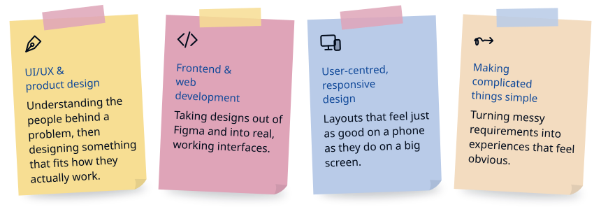
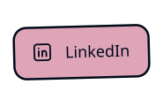
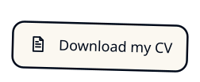
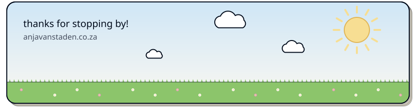

<div align="center">

<a href="https://www.anjavanstaden.co.za/">
  <picture>
    <source media="(prefers-color-scheme: dark)" srcset="assets/header-dark.svg" />
    
  </picture>
</a>

<picture>
  <source media="(prefers-color-scheme: dark)" srcset="https://readme-typing-svg.demolab.com?font=Familjen+Grotesk&weight=600&size=22&pause=1200&color=8FB0E6&center=true&vCenter=true&width=640&lines=I+like+making+software+feel+easy+to+use.;Turning+complex+requirements+into+simple+UX.;Final-year+CS+%26+Operations+Research+student.;Based+in+Stellenbosch%2C+South+Africa." />
  
</picture>

<br />


</div>

<h3>
  <picture>
    <source media="(prefers-color-scheme: dark)" srcset="assets/tab-about-dark.svg" />
    
  </picture>
</h3>

I'm a final-year **BSc Computer Science and Operations Research** student at **Stellenbosch University**, graduating in November 2026.

What I enjoy most about building things isn't just making them work. It's thinking about how someone will actually *use* them. I like taking an idea or a requirement and turning it into something practical, intuitive and visually clear.

Working as a **Data Structures and Algorithms learning assistant** taught me to explain difficult ideas simply, and to be patient while people work through them. I try to bring that same clarity to the interfaces I design.

```ts
const anja = {
  studying:   "BSc Computer Science + Operations Research @ Stellenbosch University",
  graduating: "November 2026",
  building:   "my portfolio site",
  learning:   "German",
  lookingFor: "my first role in UI/UX design or software engineering",
  openTo:     ["South Africa", "Germany"],
};
```

<h3>
  <picture>
    <source media="(prefers-color-scheme: dark)" srcset="assets/tab-into-dark.svg" />
    
  </picture>
</h3>

<picture>
  <source media="(prefers-color-scheme: dark)" srcset="assets/interests-dark.svg" />
  
</picture>

<h3>
  <picture>
    <source media="(prefers-color-scheme: dark)" srcset="assets/tab-skills-dark.svg" />
    
  </picture>
</h3>

<table>
  <tr>
    <td><b>Design &amp; prototyping</b></td>
    <td>
      
      
    </td>
  </tr>
  <tr>
    <td><b>Frontend &amp; web</b></td>
    <td>
      
      
      
      
      
      
    </td>
  </tr>
  <tr>
    <td><b>Languages</b></td>
    <td>
      
      
      
      
      
      
      
    </td>
  </tr>
  <tr>
    <td><b>Concurrent programming</b></td>
    <td>
      
      
    </td>
  </tr>
  <tr>
    <td><b>Databases</b></td>
    <td>
      
      
      
    </td>
  </tr>
  <tr>
    <td><b>Modelling &amp; optimisation</b></td>
    <td>
      
      
    </td>
  </tr>
  <tr>
    <td><b>Version control &amp; DevOps</b></td>
    <td>
      
      
      
      
      
    </td>
  </tr>
  <tr>
    <td><b>Project &amp; collaboration</b></td>
    <td>
      
      
      
      
    </td>
  </tr>
</table>

<h3>
  <picture>
    <source media="(prefers-color-scheme: dark)" srcset="assets/tab-activity-dark.svg" />
    
  </picture>
</h3>

<picture>
  <source media="(prefers-color-scheme: dark)" srcset="assets/contrib-3d-dark.svg" />
  
</picture>

<h3>
  <picture>
    <source media="(prefers-color-scheme: dark)" srcset="assets/tab-projects-dark.svg" />
    
  </picture>
</h3>

<div align="center">

My design work and case studies live on my portfolio site, where I walk through the problem, my process and the decisions behind each design.

<a href="https://www.anjavanstaden.co.za/projects">
  <picture>
    <source media="(prefers-color-scheme: dark)" srcset="assets/btn-portfolio-dark.svg" />
    
  </picture>
</a>

</div>

<h3>
  <picture>
    <source media="(prefers-color-scheme: dark)" srcset="assets/tab-contact-dark.svg" />
    
  </picture>
</h3>

<div align="center">

I'd love to hear about UI/UX or software roles, interesting projects, or just to chat about design.

<a href="mailto:anvnstaden@gmail.com"><picture><source media="(prefers-color-scheme: dark)" srcset="assets/btn-email-dark.svg" /></picture></a><a href="https://www.linkedin.com/in/anja-van-staden"><picture><source media="(prefers-color-scheme: dark)" srcset="assets/btn-linkedin-dark.svg" /></picture></a><a href="https://www.anjavanstaden.co.za/Anja-vanStaden-CV-Oct2026.pdf"><picture><source media="(prefers-color-scheme: dark)" srcset="assets/btn-cv-dark.svg" /></picture></a>

</div>

<br />

<picture>
  <source media="(prefers-color-scheme: dark)" srcset="assets/footer-dark.svg" />
  
</picture>
